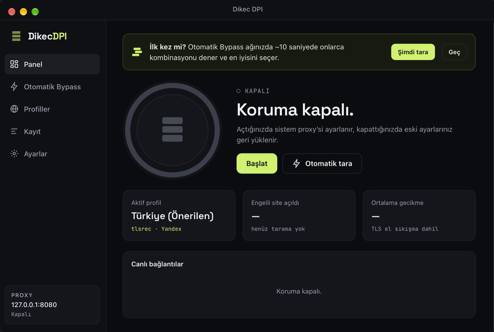

<div align="center">

# Dikec DPI

**DPI engellerini aşan, ağınızı kendi tarayıp en iyi ayarı seçen proxy.**
Menü çubuğu uygulaması + komut satırı aracı · macOS, Linux

[🇬🇧 English](_docs/README_en.md)



</div>

---

## Neden Dikec DPI?

Türkiye'de ve birçok ülkede siteler, **Derin Paket İncelemesi (DPI)** ile engelleniyor: operatör, HTTPS bağlantısının ilk paketindeki (TLS ClientHello) alan adını okuyup bağlantıyı kesiyor. Dikec DPI bu paketi DPI'ın okuyamayacağı şekilde parçalara bölerek gönderir. Sunucu parçaları sorunsuz birleştirir; aradaki kutu ise alan adını hiçbir parçada bütün olarak göremez.

VPN değildir: trafiğiniz başka bir sunucuya gitmez, hızınız düşmez, IP adresiniz değişmez.

## Özellikler

- **⚡ Otomatik Bypass.** Tek tıkla ağınızı tarar. Önce hangi sitelerin engelli olduğunu tespit eder, ardından 6 DNS sunucusunu ve 17+ parçalama stratejisini gerçek, sertifika doğrulamalı bağlantılarla dener ve en hızlı çalışan kombinasyonu kaydeder. Genelde 10 saniye sürer, sistem ayarlarınıza dokunmaz.
- **✂️ TLS kayıt bölme (`tlsrec`).** Bu sürüme özel yeni teknik: ClientHello'yu alan adının ortasından birden fazla TLS kaydına böler (RFC 8446 §5.1). TCP parçalarını birleştiren gelişmiş DPI'lara karşı bile çalışır. Türkiye'deki canlı testlerde engelli sitelerin tamamını açtı.
- **🌍 Hazır ülke profilleri.** Türkiye, Rusya, Kazakistan, İran, Körfez/Mısır/Pakistan, Hindistan/Endonezya, Çin ve genel profiller. Türkiye profilleri gerçek ağda doğrulandı; diğerleri bilinen DPI davranışına göre başlangıç noktasıdır ve Otomatik Bypass ile kendi ağınızda doğrulanır.
- **🖥️ Menü çubuğu uygulaması.** Tek tıkla aç/kapat ve profil değiştirme. Canlı bağlantı listesi, tarama matrisi ve kayıtlar. Simge durumu dilimlerin konumuyla gösterir: hizalı = kapalı, kayık = aktif.
- **🔒 Şifreli DNS.** UDP, DNS-over-HTTPS (Cloudflare, Google, Quad9) veya sistem DNS'i. Türkiye için varsayılan Yandex DNS'in alternatif portu (`77.88.8.8:1253`), çünkü 53. port operatörlerce ele geçirilebiliyor.
- **🛟 Güvenli kapanış.** Çıkışta sistem proxy ayarlarınız geri yüklenir. Uygulama çökse bile bir sonraki açılışta kalıntı ayarları temizler, interneti kesik bırakmaz.
- **Ve çekirdekten gelenler:** HTTP, SOCKS5 ve TUN (sistem geneli) modları, alan adına göre kurallar, TOML yapılandırma dosyası, sahte paket / TTL teknikleri (root ile), UDP desteği, DNS önbelleği.

## Kurulum

### Homebrew (macOS / Linux)

```bash
brew tap dikeckaan/dikecdpi
```

Homebrew 7 ve sonrası, üçüncü taraf tap'leri bir kez onaylamanızı ister:

```bash
brew trust dikeckaan/dikecdpi
```

Masaüstü uygulaması (macOS):

```bash
brew install --cask dikec-dpi
```

Komut satırı aracı:

```bash
brew install dikecdpi
```

> Tap ekledikten sonra paketlere kısa adlarıyla (`dikecdpi`, `dikec-dpi`) erişebilirsiniz. Tap eklemeden tek satırda: `brew install dikeckaan/dikecdpi/dikecdpi`.

### Hazır dosyalar

[Releases](https://github.com/dikeckaan/DikecDPI/releases) sayfasından işletim sisteminize uygun dosyayı indirin:

| Sistem | Dosya |
|---|---|
| macOS uygulaması (Apple Silicon + Intel) | `DikecDPI-<sürüm>-macos-universal.zip` |
| macOS komut satırı | `dikecdpi-<sürüm>-darwin-arm64.tar.gz` / `-darwin-amd64` |
| Linux | `dikecdpi-<sürüm>-linux-amd64.tar.gz` (ayrıca `arm64`, `arm`, `mipsle`, `riscv64`) |

> **macOS uyarısı:** Uygulama henüz Apple tarafından onaylanmadı (notarize edilmedi). Homebrew cask bu işi sizin yerinize halleder. Zip'i elle indirdiyseniz ilk açılışta uygulamaya sağ tıklayıp **Aç**'ı seçin.

### Kaynaktan derleme

Go 1.26+ gerekir.

```bash
git clone https://github.com/dikeckaan/DikecDPI && cd DikecDPI
```

Komut satırı aracını derlemek için:

```bash
go build -o dikecdpi ./cmd/spoofdpi
```

macOS uygulamasını derlemek için (sonuç `gui/dist/` klasörüne yazılır):

```bash
gui/build/package.sh
```

## Kullanım

### Masaüstü uygulaması

1. **Dikec DPI**'ı açın. İlk açılışta **Şimdi tara**'ya basın; Otomatik Bypass ağınıza en uygun ayarı bulur.
2. **Uygula ve başlat**'a basın. Sistem proxy'si otomatik ayarlanır, tarayıcınızda başka bir şey yapmanıza gerek yoktur.
3. Pencereyi kapatsanız da Dikec DPI menü çubuğunda çalışmaya devam eder. **Çıkış** dediğinizde eski ağ ayarlarınız geri gelir.

Test edilen siteleri **Otomatik Bypass → Test edilecek siteler** bölümünden değiştirebilirsiniz.

### Komut satırı

Türkiye ayarlarıyla başlatın (macOS'ta sistem proxy'sini otomatik ayarlar):

```bash
dikecdpi
```

Arka planda ve oturum açılınca otomatik çalıştırın:

```bash
brew services start dikecdpi
```

Belirli bir parçalama modu ve şifreli DNS ile başlatın:

```bash
dikecdpi --https-split-mode tlsrec --dns-mode https --dns-https-url https://1.1.1.1/dns-query
```

Linux'ta tarayıcıyı proxy ile başlatın:

```bash
google-chrome --proxy-server="http://127.0.0.1:8080"
```

Tüm seçenekler için `dikecdpi --help`. Parçalama modları: `tlsrec` (Türkiye varsayılanı), `chunk`, `sni`, `first-byte`, `random`, `custom`, `none`. TOML yapılandırması ve alan adına göre kurallar için [kullanıcı kılavuzuna](docs/user-guide/overview.md) bakın.

## Nasıl çalışır?

HTTPS bağlantısı, alan adını (SNI) **şifrelenmemiş** olarak taşıyan bir ClientHello paketiyle başlar. DPI bu alanı okur ve engelli bir siteyse bağlantıyı sıfırlar. Dikec DPI yerel bir proxy olarak araya girer ve bu paketi gönderirken böler:

| Mod | Ne yapar? |
|---|---|
| `tlsrec` | Paketi alan adının ortasından **birden fazla TLS kaydına** böler. Sunucu kayıtları birleştirir, DPI ise yalnızca ilk kayda bakıp alan adını eksik görür. |
| `chunk` | Paketi küçük TCP parçalarına böler (ör. 5 bayt). |
| `sni` | Alan adını bayt bayt ayrı parçalarda gönderir. |
| `first-byte` | İlk baytı ayrı gönderir. |
| `+disorder` | Parçaların bir kısmını düşük TTL ile göndererek sıralarını karıştırır. |

Otomatik Bypass bu modları farklı DNS sunucularıyla birlikte dener. Her deneme gerçek bir HTTPS isteğidir ve sertifika doğrulaması yapılır. Böylece operatörün engel sayfası ya da sıfırlanan bir bağlantı "başarılı" sayılmaz.

**Sınırlar:** IP adresi düzeyinde engellenen sitelerde (bazı ülkelerde yaygındır) paket bölmek tek başına yetmez; bu durumda VPN gerekir. Otomatik Bypass bu durumu "çalışan kombinasyon bulunamadı" olarak bildirir.

## Teşekkürler

Dikec DPI, iki açık kaynak projenin omuzlarında duruyor:

- **[xvzc/SpoofDPI](https://github.com/xvzc/SpoofDPI)**: Projenin çekirdeği. Proxy motoru, parçalama teknikleri, SOCKS5/TUN modları, kural motoru ve çok daha fazlası [@xvzc](https://github.com/xvzc) ve katkıcılarının eseri. Dikec DPI, SpoofDPI v1.6.0'ı temel alır ve upstream ile uyumlu kalacak şekilde geliştirilir. Teşekkürler!
- **[SpoofDPI-Turkiye](https://github.com/mertikavi/SpoofDPI-Turkiye)** (eski adıyla renardev/SpoofDPI-Turkiye): SpoofDPI'ı Türkiye için yapılandıran, Yandex DNS ayarını ve Türkçe belgeleri getiren ilk uyarlama. Bu proje onun devamı olarak başladı. Teşekkürler!

Windows kullanıcıları için (SpoofDPI v1 çekirdeği Windows'u desteklemiyor) Türkiye'ye özel güzel bir proje: [GoodbyeDPI-Turkey](https://github.com/cagritaskn/GoodbyeDPI-Turkey).

## Yasal uyarı

Dikec DPI, internete erişim özgürlüğü ve araştırma amacıyla geliştirilmiştir. Kullanımın bulunduğunuz ülkenin yasalarına uygun olmasından kullanıcı sorumludur.

## Lisans

[Apache 2.0](LICENSE). Upstream SpoofDPI ile aynı lisans.
