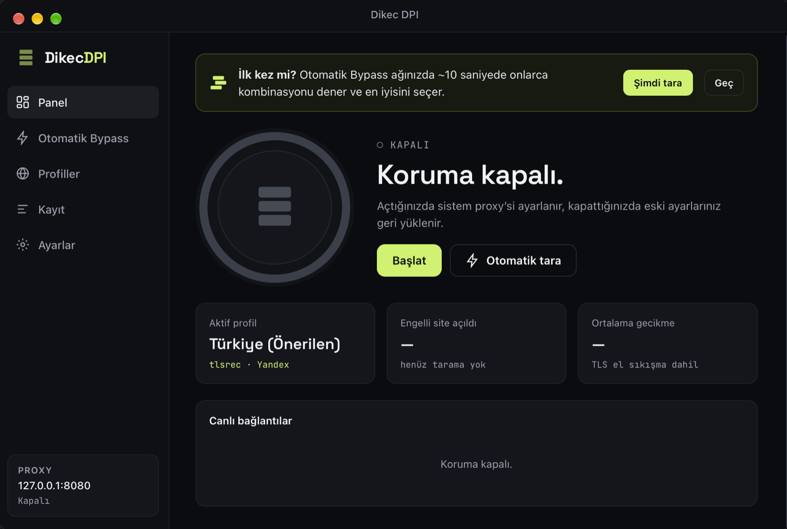

<div align="center">

# Dikec DPI

**A proxy that gets around DPI censorship, scans your network and picks the best setting by itself.**
Menu bar app + command-line tool · macOS, Linux

[🇹🇷 Türkçe](../README.md)



</div>

---

## Why Dikec DPI?

In Türkiye and many other countries sites are blocked with **Deep Packet Inspection (DPI)**: the ISP reads the domain name in the first packet of an HTTPS connection (the TLS ClientHello) and kills the connection. Dikec DPI sends that packet in pieces the DPI box cannot read. The server reassembles them without trouble; the middlebox never sees the full domain in any single piece.

It is not a VPN: your traffic does not go through another server, speed is unaffected and your IP stays the same.

## Features

- **⚡ Auto Bypass.** One click scans your network. It first detects which sites are blocked, then tries 6 DNS resolvers and 17+ fragmentation strategies with real, certificate-verified connections, and saves the fastest working combination. Usually about 10 seconds. It never touches your system settings while scanning.
- **✂️ TLS record splitting (`tlsrec`).** A new technique in this release: the ClientHello is split into several TLS records in the middle of the host name (RFC 8446 §5.1). It works even against DPI that reassembles TCP segments. In live tests in Türkiye it opened every blocked test site.
- **🌍 Country presets.** Türkiye, Russia, Kazakhstan, Iran, Gulf/Egypt/Pakistan, India/Indonesia, China and generic profiles. The Türkiye presets are verified on a real network; the others are starting points based on known DPI behaviour, to be confirmed with Auto Bypass on your own network.
- **🖥️ Menu bar app.** One-click on/off and profile switching. Live connection list, scan matrix and logs. The icon shows state through the position of its slices: aligned = off, offset = active.
- **🔒 Encrypted DNS.** UDP, DNS-over-HTTPS (Cloudflare, Google, Quad9) or the system resolver. The Türkiye default is Yandex DNS on its alternative port (`77.88.8.8:1253`), because ISPs can hijack port 53.
- **🛟 Safe exit.** Your system proxy settings are restored on quit. Even after a crash, the next launch cleans up leftover settings, so your internet is never left broken.
- **Plus everything from the core:** HTTP, SOCKS5 and TUN (system-wide) modes, per-domain rules, TOML config file, fake packet / TTL tricks (with root), UDP support, DNS cache.

## Installation

### Homebrew (macOS / Linux)

```bash
brew tap dikeckaan/dikecdpi
```

Homebrew 7+ asks you to trust third-party taps once:

```bash
brew trust dikeckaan/dikecdpi
```

Desktop app (macOS):

```bash
brew install --cask dikec-dpi
```

Command-line tool:

```bash
brew install dikecdpi
```

> After tapping, the packages are available by their short names (`dikecdpi`, `dikec-dpi`). Without tapping, in one line: `brew install dikeckaan/dikecdpi/dikecdpi`.

### Prebuilt binaries

Download the file for your system from [Releases](https://github.com/dikeckaan/DikecDPI/releases):

| System | File |
|---|---|
| macOS app (Apple Silicon + Intel) | `DikecDPI-<version>-macos-universal.zip` |
| macOS CLI | `dikecdpi-<version>-darwin-arm64.tar.gz` / `-darwin-amd64` |
| Linux | `dikecdpi-<version>-linux-amd64.tar.gz` (also `arm64`, `arm`, `mipsle`, `riscv64`) |

> **macOS note:** the app is not notarized by Apple yet. If macOS warns on first launch, go to **System Settings → Privacy & Security → Open Anyway**. You only need to do this once.

### Build from source

Requires Go 1.26+.

```bash
git clone https://github.com/dikeckaan/DikecDPI && cd DikecDPI
```

To build the command-line tool:

```bash
go build -o dikecdpi ./cmd/spoofdpi
```

To build the macOS app (output goes to `gui/dist/`):

```bash
gui/build/package.sh
```

## Usage

### Desktop app

1. Open **Dikec DPI**. On first launch press **Scan now**; Auto Bypass finds the best setting for your network.
2. Press **Apply and start**. The system proxy is configured automatically; there is nothing else to do in your browser.
3. Closing the window keeps Dikec DPI running in the menu bar. **Quit** restores your previous network settings.

You can change the test sites under **Auto Bypass → Sites to test**.

### Command line

Start with the Türkiye defaults (sets the system proxy automatically on macOS):

```bash
dikecdpi
```

Run in the background and start at login:

```bash
brew services start dikecdpi
```

Start with a specific split mode and encrypted DNS:

```bash
dikecdpi --https-split-mode tlsrec --dns-mode https --dns-https-url https://1.1.1.1/dns-query
```

On Linux, start your browser with the proxy:

```bash
google-chrome --proxy-server="http://127.0.0.1:8080"
```

Run `dikecdpi --help` for every option. Split modes: `tlsrec` (Türkiye default), `chunk`, `sni`, `first-byte`, `random`, `custom`, `none`. See the [user guide](../docs/user-guide/overview.md) for TOML config and per-domain rules.

## How it works

An HTTPS connection starts with a ClientHello packet that carries the domain name (SNI) **unencrypted**. DPI reads that field and resets the connection if the site is blocked. Dikec DPI sits in between as a local proxy and splits that packet on its way out:

| Mode | What it does |
|---|---|
| `tlsrec` | Splits the packet into **several TLS records** in the middle of the host name. The server joins the records; DPI only looks at the first record and sees a partial name. |
| `chunk` | Splits the packet into small TCP segments (e.g. 5 bytes). |
| `sni` | Sends the host name byte by byte in separate segments. |
| `first-byte` | Sends the first byte on its own. |
| `+disorder` | Sends some segments with a low TTL so they arrive out of order. |

Auto Bypass tries these modes together with different DNS resolvers. Every attempt is a real HTTPS request with certificate verification, so an ISP block page or a reset connection never counts as success.

**Limits:** sites blocked at the IP address level (common in some countries) cannot be unblocked by splitting packets alone; you need a VPN for those. Auto Bypass reports this as "no working combination found".

## Thanks

Dikec DPI stands on the shoulders of two open-source projects:

- **[xvzc/SpoofDPI](https://github.com/xvzc/SpoofDPI)**: the core of this project. The proxy engine, fragmentation techniques, SOCKS5/TUN modes, rule engine and much more are the work of [@xvzc](https://github.com/xvzc) and contributors. Dikec DPI is based on SpoofDPI v1.6.0 and is developed to stay compatible with upstream. Thank you!
- **[SpoofDPI-Turkiye](https://github.com/mertikavi/SpoofDPI-Turkiye)** (formerly renardev/SpoofDPI-Turkiye): the first adaptation of SpoofDPI for Türkiye, which brought the Yandex DNS setup and Turkish documentation. This project started as its continuation. Thank you!

For Windows users in Türkiye (the SpoofDPI v1 core does not support Windows): [GoodbyeDPI-Turkey](https://github.com/cagritaskn/GoodbyeDPI-Turkey).

## Disclaimer

Dikec DPI is built for freedom of access to information and for research. You are responsible for making sure your use complies with the laws of your country.

## License

[Apache 2.0](../LICENSE), the same license as upstream SpoofDPI.
